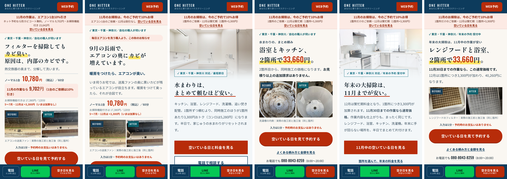
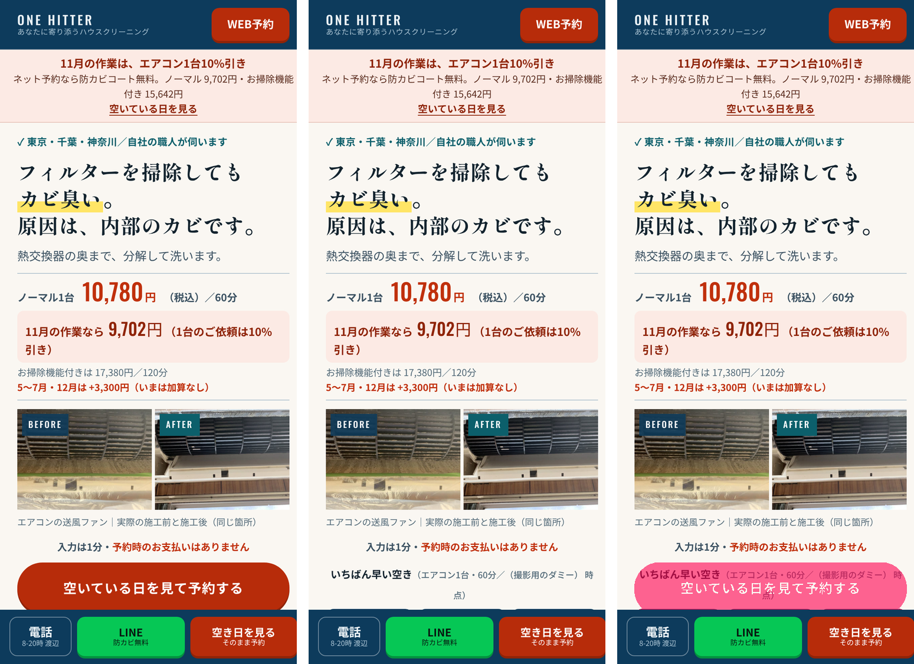
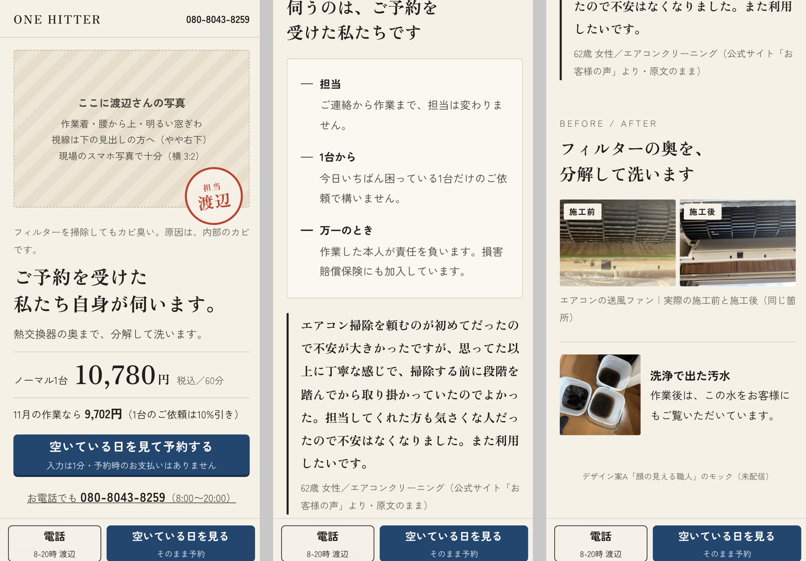
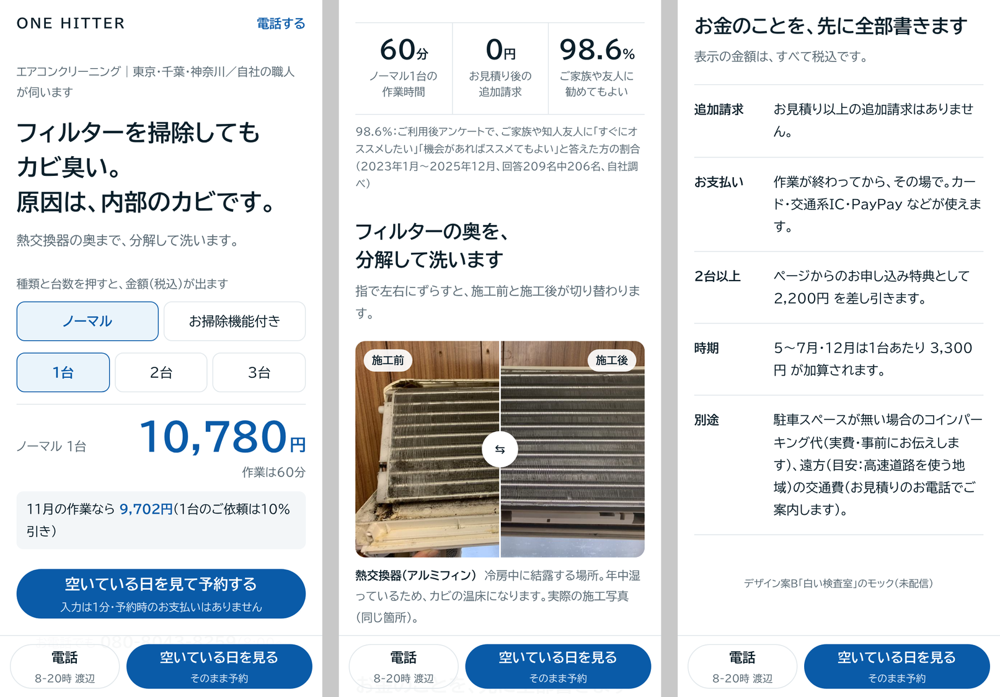
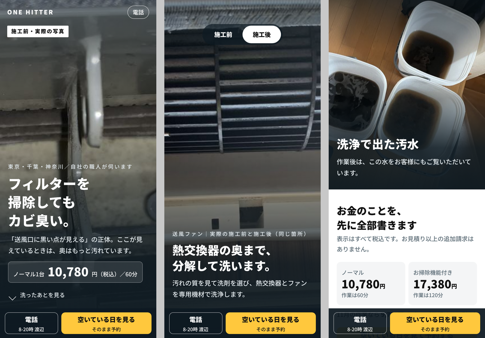

# LP のデザインと人間の心理（2026-11-01・LP・サイト担当）

オーナー指示（11/1）：「今の調査に決定的に漏れているデザインについて深く調査して。（中略）これまでのテストLPはほとんど見分けがつかない程度のデザイン／色使いの差しかない。次のテストでは抜本的に変えたパターンを出したい。デザイン①AB とデザイン②（抜本的変更）AB をテストさせてもいい」。

`docs/LP-強化調査-2026-11-01.md`（原稿・導線・信頼の材料）の**見た目の側**を埋める文書。原稿の決まりは `docs/LP原稿の書き方.md`。

- 調べたもの：論文・大規模調査を中心に約35本（第一印象・美しさと使いやすさ・信頼・色・写真と顔・書体・情報量と文化差・スキャン・スマホ・動き・A/Bの設計）。日本語の研究は少なく、あるものは優先して採った
- 見たもの：配信物 7本（aircon-c・aircon-e・kabi・mizumawari・mizumawari-b・nenmatsu・nenmatsu-b）をローカルで開き、スマホ 390×844 とPC 1280×800 で撮影。計算済みのスタイルから字の大きさ・色・太さを機械で数えた（外への通信は止め、Google Fonts だけ通した。予約の空き枠は撮影用のダミー）
- 作ったもの：抜本的に違う3案のモック（1〜3画面目）。`deploy/machi/design-mock/`（未配信）
- 確かさ：**◎ 一次資料・大規模／○ 実験1件・小規模／△ 業者の主張・出典不明**。数字より「向き」を使う

---

## 0. 結論（先に）

1. **見た目は「中身を読む前に」判断される。** 見た目の好みは 50ms で決まり、その後もほとんど変わらない（Lindgaard 2006 ◎）。17ms でも「ごちゃごちゃ度」と「それらしさ」が効く（Tuch ほか 2012 ◎）。サイトを信頼できるかの感想で最も多いのは「デザイン・見た目」（46.1%・2,684人 ◎）、健康サイトを**最初に見捨てる理由の 83% はデザイン**（Sillence 2004 ○）。**＝原稿をどれだけ直しても、見た目で先に落とされた人には読まれない。**
2. **いまの7本は、デザインとしては1本。** 7本とも `:root` の色の変数がほぼ同じ（違うのは地の色2種と、マーカー色の有無だけ）、書体も同じ3つ、ヘッダー・帯・見出し・赤いボタン・下の固定バーが同じ。C と E の CSS は行の約99%が同じで、1画面目の画素の違いは 6.1%（E の「いちばん早い空き」の1行だけ）。**オーナーの「見分けがつかない」は数字でもそのとおり。**
3. **いまの弱点は「色」より「目立たせ方」と「字」。** 1画面目に目立たせた所が 14か所、そのうち赤系が 7か所。赤い予約ボタンが、赤い価格・赤い注記・赤い帯の文字に埋もれている（目立つのは「周りと違うもの」だけ＝フォン・レストルフ効果）。字は 28種類の大きさを使い、**全文字の 26% が 12px 未満**。1画面目の文字の 54% が太字
4. **抜本的に違う方向を3つ作った。** A「顔の見える職人」（信頼・人）、B「白い検査室」（清潔・明快・触れる料金）、C「写真が主役」（証拠・汚れ→きれい）。どれも今の文言・料金・写真だけで作れる（A は渡辺さんの写真が入って完成）
5. **テストは 2×2 で組む。** 「デザイン（①今の系統／②抜本）」×「もう1つの要因（例：1画面目の見出し、のちに顔写真）」を25%ずつ。主な比較はそれぞれ全員を使えるので、2本の A/B を別々に回すより速い。指標は「予約ページへ進んだ率」。週70クリックなら、②が今の2倍効くとき2週で 84%、1.5倍なら6週で 77% の確率で見分けられる（申込の数では20週以上かかる）
6. **おすすめ**：デザイン②は**B「白い検査室」から**（今すぐ出せる・リスクが小さい）。渡辺さんの写真が撮れたら、「顔写真ブロックあり／なし」を2つ目の要因にする（A の核の部分を、どちらのデザインにも載せて測る）

---

## A. 調査

### A-1. 第一印象の速さと、見た目の判断

| 分かったこと | 確かさ | 出典 |
|---|---|---|
| ウェブページの「見た目の良さ」は **50ms** で判断され、50ms と 500ms の評価は強く相関する。第一印象が悪いと、使いやすく中身が良くても挽回しにくい | ◎（3実験・査読） | Lindgaard ほか 2006 [Behaviour & IT](https://www.nature.com/news/2006/060109/full/news060109-13.html)、[要旨](https://typeset.io/papers/attention-web-designers-you-have-50-milliseconds-to-make-a-3axej7ku89) |
| **17ms** の表示でも「視覚的な複雑さ（ごちゃごちゃ度）」と「典型性（その種類のサイトらしさ）」が好みを決める。**複雑さが低く・典型性が高い**ものが最も好まれる。典型性は表示が長くなるほど効く | ◎（2実験・119サイト・Google/バーゼル大） | Tuch ほか 2012 [論文PDF](https://research.google.com/pubs/archive/38315.pdf)、[Google の解説](https://research.google/blog/users-love-simple-and-familiar-designs-why-websites-need-to-make-a-great-first-impression/?m=1) |
| 信頼性の評価で最も多く挙がった理由は「デザイン・見た目」で、コメントの **46.1%**（2,684人・Stanford/Consumer WebWatch）。※「人の46%」ではなく「コメントの46%」 | ◎（大規模） | Fogg ほか 2002 [Consumer Reports](https://advocacy.consumerreports.org/research/how-do-people-evaluate-a-web-sites-credibility) |
| 健康情報サイトで、**早い段階で見捨てた理由のコメントの 83% がデザイン**（色・字・ごちゃごちゃ・広告っぽさ）。不信は見た目で、信頼は中身で決まる「2段階」 | ○（質的研究・CHI） | Sillence ほか 2004 [CHI 論文](https://hci.rwth-aachen.de/materials/conferences/CHI2004/1p663.pdf) |
| 美しいと使いやすく感じる（美的ユーザビリティ効果）。ATM の画面 26案で「美しい」と「使いやすい」が強く相関（1995）、使った後も美しさが使いやすさの評価に効いた（2000）。**ただし逆向き（使いやすいと美しく感じる）を示した追試もある** | ○（因果の向きは議論あり） | Kurosu & Kashimura 1995・Tractinsky ほか 2000 [PDF](https://mycourses.aalto.fi/pluginfile.php/1645430/mod_folder/content/0/Tractinsky%20%282000%29.pdf)、[Laws of UX](https://lawsofux.com/aesthetic-usability-effect/index.md) |
| 読みにくい書体で書かれた手順は「やるのが大変そう」と感じられ、やる気が下がる（運動の手順：見積り 8.2分→15.1分）。**読みやすさ＝頼みやすさ** | ○（2実験・心理学） | Song & Schwarz 2008 [PubMed](https://pubmed.ncbi.nlm.nih.gov/19000208/) |

**当社への意味**：広告から来た人は、比べる前に1画面目の見た目で「ちゃんとした業者か」「頼むのが面倒そうか」を決めている。価格が相場より高い当社は、**見た目で「高いだけの理由がありそう」と感じさせられるかどうか**が、本文を読んでもらえるかを分ける。

### A-2. 複雑さ・情報量と、文化差（日本・年配の読み手）

| 分かったこと | 確かさ | 出典 |
|---|---|---|
| 約4万人・240万件の評価：好まれる複雑さは**真ん中**（10段階の 4.2）。**複雑すぎる罰（効果量 d=2.0）は、単純すぎる罰（d=0.6）の3倍** | ◎（大規模） | Reinecke & Gajos 2014 [論文PDF](https://iis.seas.harvard.edu/papers/reinecke14visual.pdf) |
| 同じ調査で、**41歳以上は、若い人より文字が多く複雑なページを好み、彩度の低い色を好む**。一方で「色の無い、真っ白で何もないページ」は年配ほど嫌う | ◎（同上） | 同上 |
| 日本人（65人）と米国人（84人）で、ページの中の情報を探す時間を比べると、**日本人のほうが長くかかり、ページが複雑なほど差が広がった**（全体を眺めてから細部へ入る見方）。＝「日本人は情報の多いページに慣れている」は、「情報の多いページが日本人に速い」ではない | ○（CHI 2021・NTT 共著） | Baughan ほか 2021 [論文PDF](https://wildlab.cs.washington.edu/Publications_files/Baughan_Oliveira_CHI2021.pdf) |
| 日本の人気サイトは「密度の高い」デザインに集まる（2,671枚の画像分析） | △（個人の分析・査読なし） | [GIGAZINE](https://gigazine.net/gsc_news/en/20221129-peculiar-case-of-japanese-web-design) |
| 日本は不確実性を避ける傾向が強い文化（Hofstede 92/100）。先の見通し・手順・保証を求める | ○（文化の枠組み） | [Marcus & Gould 系の整理](https://www.humanfactors.com/newsletters/welcome_to_the_global_village.asp)、[Dr. Dobb's](https://drdobbs.com/are-you-cultured/184411648?pgno=2) |

**当社への意味**：顧客の中心は 30〜60代の持ち家・ファミリー。**「余白だらけで何も書いていない」は年配に効かない**が、**今のように1画面に14か所も目立つ所があるのは「複雑すぎ」側**。目標は「情報は多いが、整理されていて、目が迷わない」。日本の読み手は全体を眺めてから細部へ入るので、**1画面目の"かたまり"の数を減らす**ことが効く。

### A-3. 色：色そのものより「対比」

| 分かったこと | 確かさ | 出典 |
|---|---|---|
| 「赤いボタンが緑より 21% 勝った」（2011・HubSpot 買収前の Performable）は、**緑が基調のページだった**。赤が強いのではなく「周りと違う色が目立つ」（フォン・レストルフ効果＝孤立効果） | ○（1件の実験・解釈は一致） | [atticusli](https://atticusli.com/blog/posts/cta-button-ab-tests-why-button-color-tests-are-worthless/)、[userpeek](https://userpeek.com/blog/color-vs-contrast/) |
| 目立たせたい1つを「種類として違う見た目」にし、それ以外は静かにする。目立つ所が多いと、肝心のボタンの記憶が下がる | △（設計原則・数字なし） | [atticusli：Von Restorff](https://www.atticusli.com/blog/posts/von-restorff-effect-landing-page-design/)、[Sketchplanations](https://sketchplanations.com/the-isolation-effect) |
| 色とブランドの性格：**赤＝刺激・興奮、青＝有能さ、白＝誠実**。色を変えるとブランドの性格と購入意向が変わる | ◎（4研究・査読） | Labrecque & Milne 2012 [JAMS](https://link.springer.com/content/pdf/10.1007/s11747-010-0245-y.pdf) |
| 青は有能さ・信頼・安全と結びつく | ○ | Grohmann ほか 2013（[二次引用](https://springerlink.bibliotecabuap.elogim.com/content/pdf/10.1057/s41262-017-0086-9.pdf)） |
| 白＝純粋・簡素、青＝信頼、緑＝健康。**彩度の高い包装の消毒剤は「よく効く」と感じられ、使う量が減った** | ○（食品・日用品の実験） | [PMC：包装の色](https://www.ncbi.nlm.nih.gov/pmc/articles/PMC11475816/)、[URI 2025](https://www.uri.edu/news/2025/05/uri-research-shows-consumers-perceive-products-with-bold-colors-as-more-effective/) |
| 日本人は白を好む割合が諸外国より高い（日本色彩研究所の経年調査の引用） | ○ | [早稲田大学 論文](https://waseda.repo.nii.ac.jp/record/23809/files/Honbun-4658_10.pdf) |
| 同業大手7社の実測（8/28・9/6 当社調査）：地は白か寒色寄りの白、清潔感は青が担い、CTA は彩度の高い赤・マゼンタ。黒地は0社 | ◎（実測） | `docs/lp-design-research.md` |

**当社への意味**：色の「正解」を探すより、**「ボタンだけが違う色」にする**ほうが確実に効く。今は予約ボタン・価格・注記・帯・ヘッダーのボタンが全部同じ赤系。清潔の連想は「白」と「水の青」、職人の連想は「生成り・墨・藍」（A案）。

### A-4. 写真：実写・顔・視線・前後

| 分かったこと | 確かさ | 出典 |
|---|---|---|
| 視線計測：**実在の人物・商品の写真はじっくり見られ、素材写真の人物は無視される**。飾りの写真も無視される | ○（NN/g の視線計測・2010年頃） | [NN/g](https://www.nngroup.com/articles/photos-as-web-content/) |
| 人の写真（顔あり）は、カナダ・ドイツ・**日本**の3か国で、写真の魅力と「人のぬくもり（社会的存在感）」を通じて**信頼を上げた**。日本の参加者は特に感情面で受け止めた | ○（90人・MIS Quarterly） | Cyr ほか 2009 [MISQ](https://aisel.aisnet.org/misq/vol33/iss3/8)、[SFU](https://beedie.sfu.ca/blog/?p=2046) |
| ただし「写真を載せれば信頼される」わけではない。**スタッフ写真は、ちゃんと使える作り（機能）と組んで初めて効く**。写真は最初の数秒の注意を集めるが、慣れると見なくなる | ○（UCL の一連の研究） | Riegelsberger ほか 2002・2003 [UCL](https://discovery.ucl.ac.uk/id/eprint/119042/) |
| 顔の**視線が商品の方を向いていると、商品が見られ、購入意向も上がる** | ○（視線計測の実験） | Palcu ほか 2017 [Frontiers](https://www.frontiersin.org/journals/psychology/articles/10.3389/fpsyg.2017.00881/full) |
| 中身と関係のない写真でも、添えるだけで文が「本当らしく」感じられる（truthiness）。48時間後も残る | ◎（複数実験・追試あり） | Newman ほか 2012 [ANU](https://researchportalplus.anu.edu.au/en/publications/nonprobative-photographs-or-words-inflate-truthiness/)、[2013追試](https://pubmed.ncbi.nlm.nih.gov/23876251/) |
| 米国の持ち家 1,040人（2025/10）：**作業員の写真と身分を事前に見ると安心する 58%**、完了の写真・動画を求める 68%（2020年の約400人調査では「写真か紹介で安心」83%） | △（業者の調査・方法は公開） | [Housecall Pro 2025](https://www.housecallpro.com/resources/home-service-customer-service-report-trends-statistics/)、[2020 ebook](https://www.housecallpro.com/wp-content/uploads/2022/09/2020-consumer-survey-ebook.pdf) |
| 家事代行の定期利用者 159人（2026/7）：利用前の不安は「家事の質」45.9%、**「他人を家に入れること」40.9%**。利用後に安心につながったのは「スタッフの人柄・距離感」 | ○（自社調査・利用者のみ） | [ピナイ（リセマム）](https://resemom.jp/release/prtimes/20260806/202985.html) |

**施工前後の写真の見せ方**（研究は少ない。上の知見からの組み立て）：
- 同じ枠・同じ角度で並べる（今の LP はできている）。「実際の施工写真・同じ箇所」の明記は truthiness を「本物の証拠」に変える
- **小さく2枚並べるより、大きく1枚を切り替える**ほうが差が見える（スマホ幅 390px で2枚並べると1枚 170px）。B案はスライダー、C案は全画面で切り替え
- 汚水の写真は「目に見える量」で伝わる。当社の強い素材

**当社への意味**：今のLPの写真8枚は全部が汚れのアップと汚水。**人が1人も写っていない**。家に人を入れるサービスで「誰が来るか」を顔で見せるのは、調査で一貫して効く方向。顔写真は視線を見出しかボタンの方へ向けて撮る。

### A-5. 書体と字（日本語・スマホ・年配）

| 分かったこと | 確かさ | 出典 |
|---|---|---|
| 画面では、**ゴシック体のほうが明朝体より文章の理解度が有意に高い**（大きさを変えても） | ○（国内の実験1件） | 元木（日本大学）[PDF](https://gssc.dld.nihon-u.ac.jp/wp-content/uploads/journal/pdf09/9-73-80-motoki.pdf) |
| 通常の本文組版では、ゴシック体は明朝体と同程度に読みやすい。「明朝は長文向き」は必ずしも正しくない | ○（科研費） | [KAKEN 15K00684](https://kaken.nii.ac.jp/en/file/KAKENHI-PROJECT-15K00684/15K00684seika.pdf) |
| UD 書体（読みやすさを設計した書体）の評価実験：明朝体は評価がはっきり分かれた | △（書体メーカー） | [フォントワークス](https://en.fontworks.co.jp/wp/wp-content/uploads/2019/12/fontworksudfonts_evi.pdf) |
| 高齢者は大きい字を好むが、大きすぎると読みにくくなる点もある（スマホの字の大きさの系統的レビュー） | ◎（レビュー） | [Frontiers 2022](https://www.frontiersin.org/articles/10.3389/fpsyg.2022.931646/full) |
| 後期高齢者の聞き取り：字の大きさ・太さだけでなく、**行間・字間・段の間のバランス**が読みやすさを決める（新聞） | ○ | [静岡文化芸術大学](https://suac.repo.nii.ac.jp/record/1635/files/09%E3%80%90%E5%8E%9F%E8%91%97%E8%AB%96%E6%96%879%E3%80%91%E5%B0%8F%E6%B5%9C%E6%9C%8B%E5%AD%90%E5%85%88%E7%94%9F_p083.pdf) |
| デジタル庁デザインシステム：本文 **16px 以上**（標準 17px・行間 1.7）、**14px は補助用途に限る**、太さは 400 と 700 | ◎（政府の基準・ミラーで確認） | [DADS（ミラー）](https://open-design.ai/design-system-assets/locales/ja/DESIGN-japan-dads.md) |
| 価格表記は「円」が国内の主流（同業 24サイトで「円」384回 vs「¥」75回） | ◎（実測） | `docs/lp-design-research.md` |

**当社への意味**：今は**見出しが明朝（Shippori Mincho B1・800）、本文の注記が 9〜11.5px**。明朝の見出しは「品・職人」の印象を作るが、スマホの小さい画面では読みにくさの側に振れやすい。年配の読み手に向けて**注記を 13px 以上、本文 16〜17px、太字は要所だけ**にする。数字は大きく、単位（円）は小さく。

### A-6. 目の動き（スキャン）と視覚的階層

| 分かったこと | 確かさ | 出典 |
|---|---|---|
| **F 型**は「目を引く手がかりが無いときの既定の読み方」（悪いパターン）。2017 の再調査でスマホでも確認。見出しと小見出しだけを拾う**レイヤーケーキ型**は、見出しが良いと起きる | ◎（NN/g の視線計測） | [NN/g F型](https://nngroup.com/articles/f-shaped-pattern-reading-web-content/)、[Smashing](https://smashingmagazine.com/2024/04/f-shape-pattern-how-users-read) |
| 見出しは「最初の2語」で中身が分かるように | ○ | 同上 |
| 1画面目に視線が集まる割合は 80%（2010）→57%（2018） | ○ | `docs/LP-強化調査-2026-11-01.md` 2-3 |

**当社への意味**：見出し（h2）だけ拾い読みしても話が通るように並べる。今の h2 は「当てはまるものを押してみてください」「頼む前の3つの心配に、先にお答えします」など、**見出しだけでは中身が分からないものが多い**。

### A-7. 信頼のデザイン（家に人を入れるサービス）

調査を当社の条件で整理すると、デザインで信頼を作る材料は次の順。

| 材料 | 根拠 | 当社でできるか |
|---|---|---|
| **来る人の顔**（作業着・実写・名前） | Cyr 2009 ○、Housecall Pro 58% △、他人を家に入れる不安 40.9% ○ | 渡辺さんの撮影と同意が要る（外に出す） |
| 本物の施工前後・汚水の写真（大きく、同じ箇所と明記） | NN/g ○、truthiness ◎ | **ある**（今の8枚） |
| 制服・作業着 | 制服の「きちんと感」→有能さ→満足（451人のシナリオ実験） ○ | 写真に写る作業着で表現 |
| 総額が先に分かる見せ方（追加料金の恐れを消す） | ドリップ価格の研究 ◎（強化調査 2-3） | ある。**見せ方を「触れる料金」に**（B案） |
| 事務所の所在地・地図（江戸川区北葛西） | 地域サービスの定番 △ | ある（今はフッターだけ） |
| 手書き・判子などの「人の手」の記号 | 研究なし。同業24社で手書き書体は0（差別化になる一方、未検証） | A案で判子だけ試す |

[制服の研究](https://openrepository.aut.ac.nz/handle/10292/14188)（AUT・2021・修士論文 ○）

### A-8. 動き・触れる要素

| 分かったこと | 確かさ | 出典 |
|---|---|---|
| 小さな反応（チェック・切り替え）は 約100ms、大きな画面の変化は 200〜300ms。動きは「何が起きたか分かる」ためだけに使う | ○（NN/g の二次引用） | [W3C の議論での引用](https://lists.w3.org/Archives/Public/public-css-archive/2025Apr/0702.html)、[ミシガン大](https://design-system.lib.umich.edu/visual-elements/motion) |
| 計算機・診断などの「触れる」要素は静的ページより申込が増えるという主張が多い（+11%〜2倍） | △（ほぼ業者） | [Outgrow](https://outgrow.co/blog/interactive-content-roi-data-driven-insights)、[ion interactive](https://ioninteractive.com/?p=15111) |
| 動きを減らす設定の人には動かさない（`prefers-reduced-motion`） | ◎（標準） | — |

**当社への意味**：今のLPにも料金シミュレーターがあるが**7〜8画面目**。B案では「種類と台数を押すと金額が出る」を1画面目に出した。動きは判子（A）・金額の切り替え（B）・前後の切り替え（C）だけに絞った。

### A-9. スマホ特有

| 分かったこと | 確かさ | 出典 |
|---|---|---|
| 1,333件の観察：片手 49%・両手で支え片手で操作 36%・両手 15%。のちの改訂で「**画面の中央が最も速く正確に触られる**」 | ○（観察研究） | Hoober 2013 [UXmatters](https://www.uxmatters.com/mt/archives/2013/02/how-do-users-really-hold-mobile-devices.php?) |
| ボタンの大きさ：Apple 44pt、Google 48dp、WCAG 2.2 は最低 24px（推奨 44px） | ◎（標準） | — |
| 画面下の固定バーはスマホで申込が増える例が多い | ○ | `docs/LP-強化調査-2026-11-01.md` 2-4 |
| ダークモードの利用率に、日本の信頼できる数字は見つからなかった（海外の愛好家調査で8割など） | △ | — |

**当社への意味**：固定バーは良い。ただ**3つ（電話・LINE・空き日）並ぶと、主役がどれか分からない**（LINE の緑がいちばん目立つ）。10/26 週の line_click は 0。モックは2つ（電話＝白抜き／予約＝塗り）にした。今のLPは `color-scheme:light` で明るい表示に固定しており、それでよい。

### A-10. 2025〜2026 の傾向と、デザインの A/B テスト

| 分かったこと | 確かさ | 出典 |
|---|---|---|
| 地域サービスの上位サイトは、1画面目に「具体的な価値・はっきりしたボタン・信頼の材料（年数・資格・口コミ）」。**技術者の顔写真で会社に顔を付ける**。流入元ごとに見出しを変える | △（業者のまとめ） | [Cube Creative](https://cubecreative.design/blog/partners/2026-home-service-page-trends-2254)、[Robben Media](https://robbenmedia.com/web-design-trends-for-2026-essential-guide-for-service-businesses-and-local-brands/) |
| 国内では「スワイプ型LP」（1画面＝1枚で横や縦にめくる）が縦長LPに勝ったという報告が多い（CVR 1.05%→2.60% など）。**同じ数字が複数の発表で使い回され、1週間・小さい母数のものもある** | △（ツール会社の発表） | [ascii](https://ascii.jp/elem/000/004/267/4267647/)、[web担](https://webtan.impress.co.jp/r/prtimes/items/000000145.000048043) |
| 対照実験では、**狙った指標を改善できた案は約3分の1**（Microsoft）。よく最適化された所ほど当たりは少ない | ◎（大規模） | Kohavi ほか（[KDD 2012](https://draft.epsy5221.education.uconn.edu/wp-content/uploads/sites/2358/2019/04/Kohavi-et-al-2012-Trustworthyness-of-research.pdf)） |
| 流入が少ないと、小さな差は原理的に検出できない（CVR 2% で 5% の差を見るのに約80万人）。**小さい店は大きな差を狙う（全面的な作り直し）か、A/B/C で1本だけ大きく変える** | ○（計算は確か・主張は業者） | [CXL](https://conversionxl.com/one-change-per-test/)、[VWO](https://vwo.com/blog/ab-test-big-changes/)、[Smashing](https://www.smashingmagazine.com/2010/08/in-defense-of-a-b-testing) |
| 作り直しは「どの要素が効いたか」が分からなくなる。勝った案の中で後から小さく詰める | ○ | 同上 |

---

## B. いまのLPのデザインの診断

撮影：`docs/img/design-now-<LP>-3gamen.png`（スマホ1〜3画面目を横に並べたもの）・`design-now-<LP>-pc.png`（PC）・`design-now-6LP-1画面目-並べ.png`・`design-now-CとE-1画面目-差分.png`。

### B-1. デザインの決まり（`:root` の変数・7本共通）

| 役割 | 変数 | 値 |
|---|---|---|
| ヘッダー・固定バーの紺 | `--ink` | `#0D3B5C` |
| 地 | `--paper` | `#FAF7F2`（生成り。mizumawari・nenmatsu だけ `#F3F7F9`） |
| 文字 | `--text` / `--text-2` / `--steel` | `#13232E` / `#3C5262` / `#536A78` |
| 予約ボタン・価格・強調 | `--cta` / `--cta-fill` / `--cta-soft` | `#C0300C` / `#B72C0A` / `#FCEAE4`（薄い赤の帯・箱） |
| 罫・チェック | `--aqua` | `#0C6B7F` |
| マーカー | `--mark` | `#FFE566` |
| LINE | — | `#06C755` |
| 書体 | — | 本文 Noto Sans JP 400/500/700、見出し Shippori Mincho B1 600/800、数字 Oswald 500/600（mizumawari は Barlow も） |
| 角丸 | — | 4・8・10・12・9999px |

### B-2. 7本は「ほとんど同じ」

| 比べたもの | 結果 |
|---|---|
| `:root` の色の変数 | **7本ともほぼ同じ**（違うのは地の色 2種と、mizumawari・nenmatsu にマーカー色の変数が無いことだけ） |
| CSS の行の一致率（aircon-c と比べて） | aircon-e **約99%**、kabi 97.2%、mizumawari-b 90.9%、nenmatsu-b 86.0%、mizumawari 52.8%、nenmatsu 50.3%（後の2つも中身の部品が違うだけで、色・書体・ボタンは同じ） |
| C と E の CSS の差 | E が「いちばん早い空き」の部品（11行）を足しただけ |
| C と E の1画面目の画素の差 | **6.1%**（3画面で 9.6%）。差は「いちばん早い空き」の1行のみ（差分の図の赤い所） |
| 6本の1画面目の共通部分 | 紺のヘッダー＋赤い「WEB予約」、薄い赤の帯、緑のチェック行、明朝の見出し、赤い大きな価格、赤い予約ボタン、紺地に「電話・緑のLINE・赤い空き日」の固定バー |

**C 対 E は「1画面目に空き日の行があるか」のテストで、デザインのテストではない。** 見た人には同じページに見える。

### B-3. 数えたもの（aircon-c・スマホ 390px・計算済みスタイルから）

| | aircon-c | kabi | mizumawari | nenmatsu | 目安 |
|---|---|---|---|---|---|
| 長さ | 16.9画面 | 17.8 | 19.6 | 21.6 | — |
| 使っている字の大きさの種類 | **28** | 27 | 27 | 29 | 6〜8 程度 |
| 12px 未満の文字の割合 | **26%** | 25% | 23% | 28% | 補助だけ（DADS：14px は補助用途） |
| いちばん小さい字 | 9px | 9px | 8.8px | 8.8px | 12〜13px |
| 1画面目の文字数 | 344 | 338 | 214 | 259 | — |
| 1画面目の文字の色の数 | **9** | 9 | 7 | 8 | 3〜4 |
| 1画面目の文字のうち太字 | **54%** | 59% | 41% | 51% | 要所だけ |
| 1画面目の「目立たせた所」（目視・aircon-c 以外は概数） | **14か所**（うち赤系 7） | 約13 | 約10 | 約11 | 1〜3 |
| Web フォントの量（ページを最後まで見たとき） | **約1.8MB・93ファイル**（CSS は 626 の @font-face） | 未計測（同じ3書体） | 未計測 | 未計測 | aircon-c の写真8枚の合計は約0.5MB |

aircon-c の1画面目で目立たせている所（14）：ヘッダーの赤いボタン／薄い赤の帯／帯の赤い太字／帯の下線リンク／緑のチェック行／黄色のマーカー／赤い大きな価格／薄い赤の箱（11月）／赤い太字の繁忙期の行／BEFORE・AFTER のラベル／赤い「予約時のお支払いはありません」／赤い予約ボタン／固定バーの3色ボタン。

### B-4. 弱点（観察と、調査との照合）

| # | 弱点 | 観察 | 調査との照合 |
|---|---|---|---|
| 1 | **予約ボタンが目立たない**（赤の使いすぎ） | 赤系が1画面に7か所。予約ボタンと同じ赤が、価格・注記・帯の文字にも使われている。固定バーではLINEの緑が最も目立つ | 目立つのは「周りと違うもの」（孤立効果 ○）。赤対緑の実験も実は対比の話 |
| 2 | **ごちゃごちゃ側に振れている** | 1画面目に色9・目立つ所14・字の大きさ6種類以上 | 複雑すぎる罰は単純すぎる罰の3倍（◎）。日本人は複雑なページで探すのが遅い（○） |
| 3 | **字が小さく、太字が多い** | 全文字の26%が12px未満、最小9px。1画面目の半分以上が太字 | 年配ほど字の小ささが効く（◎レビュー）。読みにくい字は「頼むのが大変そう」に見える（○） |
| 4 | **人が見えない** | 写真8枚はすべて汚れのアップ。人・作業着・事務所は0 | 顔が信頼を作る（Cyr ○）、他人を家に入れる不安 40.9%（○） |
| 5 | **写真が小さい** | 前後の写真は2枚並べて1枚 約170px。証拠として弱い | 大きな実写がじっくり見られる（NN/g ○） |
| 6 | **清潔感の色が弱い** | 生成りの地＋赤＋紺。「水・白」の面積が少ない（mizumawari・nenmatsu の地は青白） | 清潔＝白・水の青（○）、日本人は白を好む（○） |
| 7 | **明朝の見出しが詰め気味に見える** | Shippori Mincho B1 の 800 を 25.7px・字間広めで3行。小さい画面で「重い」 | 画面ではゴシックが理解度で有利（○）。ただし明朝は「品」の印象を作る — 案Aで意図的に残した |
| 8 | **フォントが重い** | 3書体7太さで約1.8MB。`display=swap` なので文字は先に出るが、読み込みのたびに字の形が入れ替わる | 0.1秒速くなると CVR +8〜10%（◎・強化調査 2-4） |
| 9 | **PC は「スマホの1列を真ん中に置いただけ」** | 1280px 幅で中身は約720px、両脇は空き。固定バーは画面いっぱいに LINE と空き日の2つ | PC の割合は GA4 で確かめてから（未確認）。両脇が空くと「それらしさ（典型性）」が下がるおそれ（推測） |
| 10 | **見出しだけ読んでも話が通らない** | h2 に「当てはまるものを押してみてください」「当日の作業は、この8工程です」など | レイヤーケーキ型の読み方（NN/g ◎） |

**良いところ（変えない）**：料金を1画面目に出す／総額を先に書く／実際の施工前後と汚水の写真／空き日からそのまま予約／画面下の固定バー／コントラストは WCAG AA を満たす（8/28 実測）。

---

## C. 抜本的に違うデザインの方向（3案）

モック：`deploy/machi/design-mock/<案>/index.html`（写真は `deploy/machi/design-mock/img/` に aircon-c から写した）。撮影：`docs/img/design-mock-<案>.png`（スマホ 390×844 の1〜3画面目を横に並べたもの）。文言はすべて今の aircon-c にあるもの（短く切った所はある）。新しい宣伝文句は作っていない。

| | 今の系統（①） | A 顔の見える職人 | B 白い検査室 | C 写真が主役 |
|---|---|---|---|---|
| 一言 | 説明を全部見せる | **この人が来る** | **すっきり分かる、きれいになる** | **見れば分かる** |
| 地 | 生成り `#FAF7F2` | 生成りの紙 `#F6F1E7` | 真っ白 `#FFFFFF` | 写真そのもの＋白 |
| 主の色 | 紺＋赤（7か所） | 墨＋藍（ボタンだけ） | 灰＋青（ボタンと金額だけ） | 夜の紺の影＋黄（ボタンだけ） |
| 見出しの字 | 明朝 800 | 明朝（Zen Old Mincho 700） | UD ゴシック（BIZ UDPGothic 700） | 極太ゴシック（Noto Sans JP 900） |
| 1画面目の主役 | 見出し＋6つの金額 | 渡辺さんの写真と判子 | 金額と、種類・台数のボタン | 汚れの写真1枚（全画面） |
| 1画面目の色の数（計測） | 9 | 6 | 5 | 3 |
| 字の大きさの種類（モック） | 28 | 12 | 13 | 11 |
| 12px 未満の文字 | 26% | 0% | 0% | 0% |
| 固定バー | 3つ（電話・LINE・空き日） | 2つ | 2つ | 2つ |

### C-1. 案A「顔の見える職人」（kao）

- **コンセプト**：伺うのはこの人です。会社ではなく「人」を先に見せる
- **誰に・どの心理に**：知らない人を家に入れるのが不安な人（40.9%）、女性の一人暮らし・年配の方。顔の写真は信頼を「人のぬくもり（社会的存在感）」経由で上げる（Cyr 2009、日本でも同じ向き）。大手のフランチャイズ・下請けと違う「自社の職人」を、言葉でなく顔で示す。顔の視線を見出しとボタンの方へ向けると、そこが見られる（Palcu 2017）
- **配色**：生成り `#F6F1E7`／紙の面 `#EDE5D6`／墨 `#22201C`／灰 `#6B6458`（注記・5.2:1）／藍 `#23466E`（予約ボタンだけ・白文字で 9.7:1）／朱 `#B8432F`（判子だけ）
- **字**：見出し Zen Old Mincho 700（28px・行間 1.45）、本文 Zen Kaku Gothic New 400/700（17px・行間 1.85）、注記 14px 以上。数字は明朝で大きく（38px）、円は 18px
- **写真**：1画面目の上半分に渡辺さん（作業着・腰から上・窓ぎわの自然光・視線はやや下の見出しへ）。3:2 の横長。施工前後は「作業の記録」として小さめ、汚水は手紙の挿絵のように
- **レイアウト**：手紙・作業日誌のような縦の流れ。罫線と余白で区切り、色の箱は使わない。「担当／1台から／万一のとき」を手紙の箇条で。お客様の声（62歳 女性「担当してくれた方も気さくな人だったので不安はなくなりました」）を明朝で大きく
- **動き**：判子が最初に1回だけ「ぽん」と押される（0.5秒）。ほかは動かさない
- **今との違い**：人が主役、赤が消える、色の箱が消える、ボタンは藍
- **リスク**：**渡辺さんの写真と掲載の同意が無いと成り立たない**（外に出す＝オーナー確認）。写真の出来がそのまま印象になる。判子・明朝は「古い・高そう」と取られる可能性。渡辺さんが来られない日に別の人が行くと約束と食い違う
- **速さ**：Zen Old Mincho・Zen Kaku Gothic New の2書体3太さ。モックの3画面で約0.7MB。本番は使う字だけに絞って自前で置けば 100〜200KB 程度にできる見込み

### C-2. 案B「白い検査室」（shiro）

- **コンセプト**：すっきり分かる。白と水の青だけで、清潔と明朗会計を見せる
- **誰に・どの心理に**：相場と比べて来る人（頼まない理由の1位が料金）。複雑さを下げると第一印象が上がる（Tuch・Reinecke ◎）。白＝誠実・純粋、青＝有能・信頼（◎○）。種類と台数を押すと金額が変わる＝自分で確かめた金額は信じやすく、「あとから足される」恐れが消える（ドリップ価格の逆）。年配にも読みやすい UD 書体
- **配色**：白 `#FFFFFF`／霧 `#F3F6F8`（面の区切り）／文字 `#0B1F2A`／補足 `#5B6B75`（5.5:1）／罫 `#E1E7EB`／青 `#0A5BA8`（ボタン・選んだ所・金額だけ。白文字で 6.8:1）
- **字**：BIZ UDPGothic（モリサワの UD 書体）400/700 の1書体だけ。見出し 28px、本文 17px・行間 1.8、注記 12.5〜14px。金額 46px（等幅数字）
- **写真**：施工前後を「指でずらすスライダー」で1枚に重ね、幅いっぱい（4:3）。小さく2枚並べない
- **レイアウト**：余白を大きく、罫線1本で区切る。1画面目：見出し→種類・台数のボタン→金額→11月の金額→予約ボタン。2画面目：数字3つ（60分・0円・98.6%＋出典）とスライダー。3画面目：お金のことを表で
- **動き**：ボタンを押すと金額が 0.15秒で入れ替わる。スライダー。ほかは動かさない
- **今との違い**：色の数 9→5、赤が無い、明朝が無い、計算機が7画面目→1画面目、写真が大きい
- **リスク**：「病院・役所っぽい、冷たい」と取られる可能性（年配は色の無いページを嫌う ◎ ので、青を少し多めにする余地あり）。同業の大手（青白）と似て**典型性は上がるが、埋もれる**かもしれない。人の気配が無い（→顔写真ブロックを足せる設計）
- **速さ**：1書体2太さ。モックの3画面で約0.4MB、3案で最も軽い。BIZ UDPGothic は端末に無いので Web フォントは必須

### C-3. 案C「写真が主役」（shashin）

- **コンセプト**：見れば分かる。1画面＝写真1枚、文字は最小限
- **誰に・どの心理に**：長い説明を読まない人、「本当にきれいになるの？」が気になる人。写真は文を本当らしく感じさせる（truthiness ◎）。施工前→施工後を同じ枠で切り替えると、変化そのものが記憶に残る。国内で増えている「1画面1枚」の型（スワイプ型LP △）に近い
- **配色**：写真／夜の紺 `#0E1A22`（写真の上の影だけ・白文字で 17.7:1）／白 `#FFFFFF`／雲 `#F4F5F6`（金額の箱）／黄 `#FFC83D`（予約ボタンだけ・黒文字で 12.2:1）
- **字**：Noto Sans JP 900（見出し 29〜34px）と 500（本文 16〜17px）
- **写真**：1画面目は吹出口の施工前を全画面。2画面目は送風ファンを全画面で「施工前／施工後」を切り替え（半分見えたら1回だけ自動で施工後に）。3画面目は汚水。そのあと白地で金額と予約
- **レイアウト**：画面ごとに止まるスクロール（scroll-snap・弱め）。写真の下側に影を敷き、その上に白い文字
- **動き**：前後の切り替え（0.35秒のフェード）、下向きの矢印がゆっくり揺れる。動きを減らす設定の人には動かさない
- **今との違い**：文字量が1画面目 344→126字、写真が主役、ボタンは黄色
- **リスク**：**写真の質が足りない**（800×600 のスマホ写真を全画面に引き伸ばすと粗い。原寸の写真が要る）。施工後の写真も暗く、「きれいになった」がひと目で伝わりにくい。汚れの全画面は「気持ち悪い」と離脱する人もいる。黄色と黒は「安売り」に見える可能性。料金が2画面ぶん下に下がる（今の強み「料金を先に」が弱まる）。オーナーが9月に「黒い帯は清潔感と合わない」と指摘した系統に近い（影は写真の上だけにした）
- **速さ**：Noto Sans JP 2太さ。モックの3画面で約0.6MB。写真が大きいぶん、1画面目の写真（LCP）を軽く・先に読む工夫が要る

### C-4. 3案の比べ方と、おすすめ

| | 効く相手 | 今すぐ出せるか | 今との差（見た瞬間） | 主なリスク |
|---|---|---|---|---|
| A 顔 | 不安が強い人・年配・女性 | ✕（写真が要る） | 大 | 写真次第・同意が要る |
| B 白 | 比べて来る人・全般 | ◯ | 大 | 冷たい・埋もれる |
| C 写真 | 読まない人・効果を疑う人 | △（写真の質） | 最大 | 粗い写真・料金が下がる |

**おすすめ：デザイン②は B から。** 理由：(1) 今ある素材だけで出せる、(2) 調査で最も確かな「複雑さを下げる」「総額を自分で確かめる」に乗っている、(3) 失敗しても失うものが小さい。**A の核（顔写真ブロック）は、写真が撮れしだい B にも ① にも載せて、2つ目の要因として測る。** C は写真を原寸で撮り直せるなら次の候補。

---

## D. テストの組み方

### D-1. 前提の数字

- 広告：週 40〜100 クリック（真ん中 70）。申込：週2件前後（1クリックあたり 約2.9%）。予約ページへ進む率：約 15%（10月の入口の直しの後）
- いまの /aircon/ は、初回だけ 50:50 で /aircon-c/ か /aircon-e/ に移し、同じ人には同じ版（`tools/furiwake-aircon.py`、`docs/LP-エアコンC対E-振り分け.md`）。C 対 E は 11/10 まで

### D-2. 何週で何が言えるか（計算）

**申込の数で決めるのは無理**：申込率 2.9%→5.8%（2倍）を普通の検定（有意水準5%・検出力80%）で見るには、1案 773 クリック＝合計 1,546。週70なら **22週**。

**予約ページへ進んだ率（15%）なら**：

| ②の本当の効き方 | 必要なクリック（2案の合計） | 週70なら | 週40なら | 週100なら |
|---|---|---|---|---|
| 15%→20%（1.33倍） | 1,806 | 26週 | 45週 | 18週 |
| 15%→22.5%（1.5倍） | 844 | 12週 | 21週 | 8週 |
| 15%→30%（2倍） | 236 | **3.4週** | 5.9週 | 2.4週 |

普通の検定は厳しすぎるので、**「②が①より良い確率」（ベイズ）で 90% を超えたら採用**、とする場合のシミュレーション（週70・半分ずつ・300回）：

| ②の本当の効き方 | 2週 | 4週 | 6週 | 8週 |
|---|---|---|---|---|
| 差なし（15%→15%） | 11% | 14% | 10% | 11% ←「間違って採用」の確率 |
| 1.5倍（→22.5%） | 45% | 61% | **77%** | 83% |
| 2倍（→30%） | **84%** | 98% | 99% | 100% |

→ **抜本的な変更なら 2〜6週で見当がつく。言い回しの小さな違い（1.1〜1.2倍）は、この流入では何か月やっても分からない。** これが「大きく変える」理由。

### D-3. 組み方：2×2（おすすめ）

オーナーの「デザイン①AB とデザイン②AB」を、**2つの要因の掛け合わせ**として組む。

| | 要因2：なし（今の見出し） | 要因2：あり（例：季節の見出し／のちに顔写真ブロック） |
|---|---|---|
| デザイン①（今の系統） | /aircon-c/（今のまま） | ①＋要因2 |
| デザイン②（B 白い検査室） | ②（B） | ②＋要因2 |

- 4つに 25% ずつ振り分ける。**「①対②」は上の行と下の行の比べ＝全員を使う**ので、50:50 の A/B と同じ速さで分かる。「要因2あり対なし」も左右の列の比べで全員を使う。**同じ流入で2つの問いに同時に答えられる**
- 要因2は「どちらのデザインにも同じ形で載せられるもの」にする。いちばん良いのは**顔写真ブロック**（写真が撮れたら）。それまでは**1画面目の見出しの季節版**（強化調査の弱点3）
- 「デザイン①の中の A 対 B」だけ、「②の中の A 対 B」だけ、を別々に見ると、それぞれ 25% ずつしか使えず、上の表の倍の期間がかかる。**別々の2本の A/B として回すより、掛け合わせで読むほうが速い**
- 注意：②と要因2の相性（②のときだけ顔写真が効く等）を細かく見るには量が足りない。大きな食い違いが出たら、そのとき追加で確かめる

**もっと速く知りたいとき**：まず **①対②の 50:50 だけ**を 2〜4週。勝ったほうを土台に、次の 2〜4週で要因2を試す（順番に1つずつ）。

### D-4. 指標

| | 指標 | 理由 |
|---|---|---|
| 主 | **予約ページへ進んだ人の割合**（ユーザー単位） | 毎週の数がいちばん多く、申込に近い |
| 主（並べて見る） | 連絡の合計＝予約完了＋LP内フォーム＋電話タップ（＋LINE） | 固定バーを2つにすると、電話や LINE への流れが変わる。**予約だけ増えて電話が減った、を見逃さない** |
| 副 | 料金を触った割合（B の種類・台数ボタン、①の計算機）、50%までスクロールした割合、前後写真を切り替えた割合 | なぜ勝ったか・負けたかの手がかり |
| 歯止め | 申込（generate_lead・booking_submit）の件数 | 主の指標が良くても申込が明らかに減ったら止める |
| 期限 | **最長6週**。90%を超えたら採用、6週で決まらなければ「差は小さい」として、作業の手間が少ないほうを残す | 季節（12月の繁忙期加算）をまたぐ前に区切る |

同じ期間に両方を出すので、季節や入札の変化（10/16〜27 のような表示の減少）は両方に同じようにかかる。前後比較ではなくこの形にする理由。

### D-5. 振り分けの仕組みの広げ方（`tools/furiwake-aircon.py`）

今の仕組みはそのまま使える。変えるのは次の所だけ。

1. 版を `c`・`e` の2つから、**4つ（例：`c`＝①なし、`g`＝①あり、`f`＝②なし、`h`＝②あり）**に。`Math.random()` を 25% ずつに。移り先は `/aircon-c/`・`/aircon-g/`・`/aircon-f/`・`/aircon-h/`（新しいディレクトリは固定URLの5本に当たらない。/aircon/ の URL は変えない）
2. 版を残すキーを新しくする（`oh_ab_aircon_ce` → 例 `oh_ab_aircon_2611`）。C 対 E の割り当ては持ち越さない
3. 各ページの `OH_M.page` と GA4 の config に、`lp_variant`（C・G・F・H）に加えて **`lp_design`（1／2）と `lp_factor2`（0／1）** を送る。判定表は「デザイン別」「要因2別」に足し上げるだけで読める（measurement に依頼。判定表は measurement の持ち物）
4. 確認用の `#ab-c` などを4つに。JS が動かない人は今どおり C
5. aircon-e（今の E）は C 対 E の判定が出たら、勝ったほうを ① の土台にする。E の「いちばん早い空き」が勝てば、①にも②にも入れる

---

## E. 次の一手（案）

| 順 | やること | 誰 | 確認 |
|---|---|---|---|
| 1 | オーナーに下の質問（デザイン②の案・テストの組み方・撮影） | CMO 経由 | — |
| 2 | 選ばれた案を本番の部品（予約ボタンの計測・フォーム・料金計算・固定バー）まで作り、`deploy/machi/` に置く | lp | 事後報告 |
| 3 | フォントを「使う字だけ」に絞って自前で置く（今の①も。約1.8MB→数百KB見込み） | lp | 事後報告 |
| 4 | 振り分けを4つに広げる（D-5）・GA4 に lp_design と lp_factor2 | lp・measurement | CMO |
| 5 | 渡辺さんの撮影（作業着・窓ぎわ・視線の向き・施工後の引きの写真も原寸で） | オーナー・渡辺さん | **外に出す** |
| 6 | 配信（C 対 E の判定 11/10 のあと） | lp | **外に出す**・`check-tracking.py` を通す |

---

## F. オーナーに選んでもらう質問

1. **デザイン②（抜本的に変える版）にどれを使うか**
   - A 顔の見える職人：信頼に最も効く見込み。ただし渡辺さんの写真が撮れるまで出せない
   - **B 白い検査室**：今の素材ですぐ出せる。清潔・明朗会計。冷たく見える危険
   - C 写真が主役：見た瞬間の差が最大。写真の撮り直しが要り、料金が下に下がる
   - B に A の顔写真ブロックを足したもの：写真が撮れてから
   - おすすめ：**B**（すぐ出せて、調査の確かな所に乗っている。顔写真は2つ目の要因として後から全部の版で測る）
2. **テストの組み方**
   - **2×2（デザイン①②×見出し or 顔写真、25%ずつ）**：2つの問いに同時に答えられる。①対②は 50:50 と同じ速さ
   - ①対②の 50:50 だけ：いちばん単純。②が勝ったら次に細部を詰める
   - ①の中の A/B と ②の中の A/B を別々に：それぞれの答えは出るが、倍の期間がかかる
   - おすすめ：**2×2**（同じ流入で得られる答えが最も多い）
3. **渡辺さんの写真を撮って LP に載せてよいか**（外に出す）
   - 顔あり（作業着・名前も）：調査で最も効く方向
   - 顔なし（手元・後ろ姿・作業中）：同意の負担は軽いが、「誰が来るか」は伝わりにくい
   - 載せない：A案と顔写真ブロックはやめる
   - おすすめ：**顔あり**（他人を家に入れる不安が 4割。顔は日本でも信頼を上げた）
4. **固定バーを3つ（電話・LINE・空き日）から2つ（電話・空き日）にしてよいか**（デザイン②のほう）
   - 2つにする：予約ボタンが目立つ。LINE は本文の中へ（防カビ無料の案内は本文に残す）
   - 3つのまま：LINE からの相談を残す。主役は分かりにくいまま
   - おすすめ：**②では2つ**（10/26 週の LINE タップは 0。①は3つのまま残るので、比べられる）
5. **何で勝ち負けを決めるか**
   - **予約ページへ進んだ率で、最長6週**：2倍効くなら2週、1.5倍なら6週で見当がつく
   - 申込の件数で：確かだが、20週以上かかる
   - おすすめ：**予約ページへ進んだ率＋連絡の合計を並べて見る**（申込は歯止めとして見る）

---

## 出典（本文に出たもの）

**第一印象・美しさ・信頼**
- Lindgaard ほか 2006（[Nature の記事](https://www.nature.com/news/2006/060109/full/news060109-13.html)、[要旨](https://typeset.io/papers/attention-web-designers-you-have-50-milliseconds-to-make-a-3axej7ku89)） ◎
- Tuch ほか 2012（[論文PDF](https://research.google.com/pubs/archive/38315.pdf)、[Google Research ブログ](https://research.google/blog/users-love-simple-and-familiar-designs-why-websites-need-to-make-a-great-first-impression/?m=1)） ◎
- Fogg ほか 2002 Stanford/Consumer WebWatch（[Consumer Reports](https://advocacy.consumerreports.org/research/how-do-people-evaluate-a-web-sites-credibility)） ◎
- Sillence ほか 2004（[CHI 論文](https://hci.rwth-aachen.de/materials/conferences/CHI2004/1p663.pdf)、[Northumbria](https://researchportal.northumbria.ac.uk/en/publications/trust-and-mistrust-of-online-health-sites/)） ○
- Tractinsky ほか 2000（[PDF](https://mycourses.aalto.fi/pluginfile.php/1645430/mod_folder/content/0/Tractinsky%20%282000%29.pdf)）・Kurosu & Kashimura 1995（[Laws of UX](https://lawsofux.com/aesthetic-usability-effect/index.md)） ○
- Song & Schwarz 2008（[PubMed](https://pubmed.ncbi.nlm.nih.gov/19000208/)） ○

**複雑さ・文化差**
- Reinecke & Gajos 2014（[論文PDF](https://iis.seas.harvard.edu/papers/reinecke14visual.pdf)、[Harvard](https://eecs.harvard.edu/~kgajos/papers/2014/reinecke14visual.shtml)） ◎
- Baughan ほか 2021（[論文PDF](https://wildlab.cs.washington.edu/Publications_files/Baughan_Oliveira_CHI2021.pdf)） ○
- [GIGAZINE：日本のサイトのデザイン](https://gigazine.net/gsc_news/en/20221129-peculiar-case-of-japanese-web-design) △
- [Human Factors：文化とUI](https://www.humanfactors.com/newsletters/welcome_to_the_global_village.asp)、[Dr. Dobb's](https://drdobbs.com/are-you-cultured/184411648?pgno=2) ○

**色**
- Labrecque & Milne 2012（[JAMS](https://link.springer.com/content/pdf/10.1007/s11747-010-0245-y.pdf)） ◎
- [ブランドと色の総説（Grohmann 2013 の引用）](https://springerlink.bibliotecabuap.elogim.com/content/pdf/10.1057/s41262-017-0086-9.pdf) ○
- [PMC：包装の色と信頼](https://www.ncbi.nlm.nih.gov/pmc/articles/PMC11475816/)、[URI：彩度と効き目の感じ方](https://www.uri.edu/news/2025/05/uri-research-shows-consumers-perceive-products-with-bold-colors-as-more-effective/) ○
- [早稲田大学：色彩嗜好](https://waseda.repo.nii.ac.jp/record/23809/files/Honbun-4658_10.pdf) ○
- [atticusli：ボタンの色の議論](https://atticusli.com/blog/posts/cta-button-ab-tests-why-button-color-tests-are-worthless/)、[userpeek：色より対比](https://userpeek.com/blog/color-vs-contrast/)、[atticusli：Von Restorff](https://www.atticusli.com/blog/posts/von-restorff-effect-landing-page-design/)、[Sketchplanations](https://sketchplanations.com/the-isolation-effect) △〜○

**写真・顔・信頼**
- [NN/g：Photos as Web Content](https://www.nngroup.com/articles/photos-as-web-content/) ○
- Cyr ほか 2009（[MIS Quarterly](https://aisel.aisnet.org/misq/vol33/iss3/8)、[SFU](https://beedie.sfu.ca/blog/?p=2046)） ○
- Riegelsberger ほか（[UCL：Face it](https://discovery.ucl.ac.uk/id/eprint/119042/)、[UCL](https://discovery.ucl.ac.uk/id/eprint/20285/)） ○
- Palcu ほか 2017（[Frontiers](https://www.frontiersin.org/journals/psychology/articles/10.3389/fpsyg.2017.00881/full)） ○
- Newman ほか 2012（[ANU](https://researchportalplus.anu.edu.au/en/publications/nonprobative-photographs-or-words-inflate-truthiness/)）、2013（[PubMed](https://pubmed.ncbi.nlm.nih.gov/23876251/)） ◎
- [Housecall Pro 2025 調査](https://www.housecallpro.com/resources/home-service-customer-service-report-trends-statistics/)、[2020 調査](https://www.housecallpro.com/wp-content/uploads/2022/09/2020-consumer-survey-ebook.pdf) △
- [ピナイ・インターナショナル 2026/7（リセマム）](https://resemom.jp/release/prtimes/20260806/202985.html) ○
- [AUT：制服と有能さ](https://openrepository.aut.ac.nz/handle/10292/14188) ○

**書体・字**
- [元木：明朝とゴシックの理解度](https://gssc.dld.nihon-u.ac.jp/wp-content/uploads/journal/pdf09/9-73-80-motoki.pdf) ○、[KAKEN 15K00684](https://kaken.nii.ac.jp/en/file/KAKENHI-PROJECT-15K00684/15K00684seika.pdf) ○、[フォントワークス UD](https://en.fontworks.co.jp/wp/wp-content/uploads/2019/12/fontworksudfonts_evi.pdf) △
- [Frontiers 2022：高齢者と字の大きさ](https://www.frontiersin.org/articles/10.3389/fpsyg.2022.931646/full) ◎、[静岡文化芸術大学：新聞の読みやすさ](https://suac.repo.nii.ac.jp/record/1635/files/09%E3%80%90%E5%8E%9F%E8%91%97%E8%AB%96%E6%96%879%E3%80%91%E5%B0%8F%E6%B5%9C%E6%9C%8B%E5%AD%90%E5%85%88%E7%94%9F_p083.pdf) ○
- [デジタル庁デザインシステム（ミラー）](https://open-design.ai/design-system-assets/locales/ja/DESIGN-japan-dads.md) ◎

**スキャン・スマホ・動き**
- [NN/g：F-Shaped Pattern](https://nngroup.com/articles/f-shaped-pattern-reading-web-content/)、[Smashing 2024](https://smashingmagazine.com/2024/04/f-shape-pattern-how-users-read) ◎
- [Hoober 2013（UXmatters）](https://www.uxmatters.com/mt/archives/2013/02/how-do-users-really-hold-mobile-devices.php?) ○
- [W3C での NN/g の引用（動きの長さ）](https://lists.w3.org/Archives/Public/public-css-archive/2025Apr/0702.html)、[ミシガン大 Motion](https://design-system.lib.umich.edu/visual-elements/motion) ○
- [Outgrow](https://outgrow.co/blog/interactive-content-roi-data-driven-insights)、[ion interactive](https://ioninteractive.com/?p=15111) △

**傾向・A/B テスト**
- [Cube Creative 2026](https://cubecreative.design/blog/partners/2026-home-service-page-trends-2254)、[Robben Media 2026](https://robbenmedia.com/web-design-trends-for-2026-essential-guide-for-service-businesses-and-local-brands/) △
- [ascii：スワイプ型LP](https://ascii.jp/elem/000/004/267/4267647/)、[web担当者Forum](https://webtan.impress.co.jp/r/prtimes/items/000000145.000048043) △
- [Kohavi ほか 2012（KDD）](https://draft.epsy5221.education.uconn.edu/wp-content/uploads/sites/2358/2019/04/Kohavi-et-al-2012-Trustworthyness-of-research.pdf) ◎
- [CXL：One change per test](https://conversionxl.com/one-change-per-test/)、[VWO：Big changes](https://vwo.com/blog/ab-test-big-changes/)、[Smashing：In Defense of A/B Testing](https://www.smashingmagazine.com/2010/08/in-defense-of-a-b-testing) ○

**社内**：`docs/lp-design-research.md`（同業24社・大手7社の実測）、`docs/LP-強化調査-2026-11-01.md`、`docs/LP-エアコンC対E-振り分け.md`、`docs/photo-credits.md`
